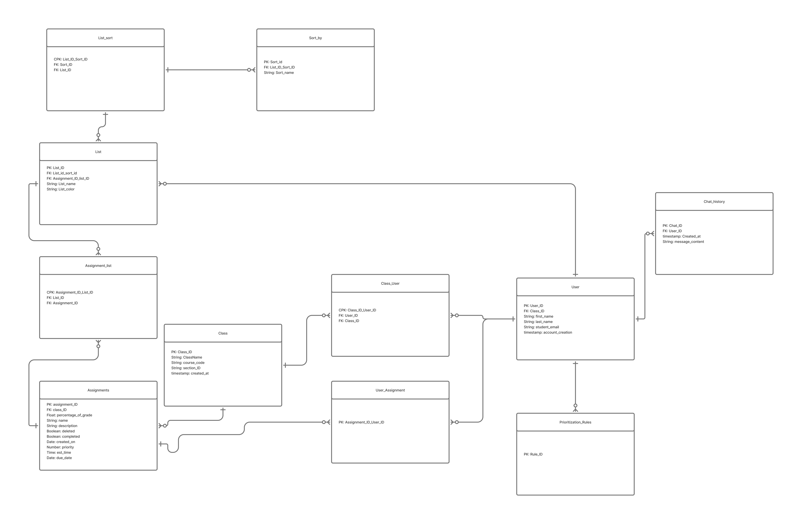

# Canvas To-Do Prioritizer — IS 401 Module 05

**AI assignment creation update — October 30, 2026:** the chatbot now collects assignment details into a saved draft, asks for missing answers, and offers a review before creation. The manual form and reviewed chat draft use one database creation function. See [AI assignment creation](docs/ai-assignment-creation.md) for setup, the system prompt, limits, and verification. This update supersedes the earlier advice-only behavior below.

**Assignment creation update — October 30, 2026:** the Add Assignment form saves new tasks directly to Supabase. The app displays database assignments only; it does not create or load device-only assignments. The migration was applied to the live project, and a rollback-only database check passed creation, completion, and account isolation. See [Database-backed assignment creation](#database-backed-assignment-creation).

**AI update — October 30, 2026:** saved conversations, a read-only OpenAI backend, and account privacy are implemented. The migration and backend are deployed; automated and live database checks passed. After the API project was funded, real replies, follow-up context, refresh persistence, and advice-only behavior passed in the signed-in preview. See the AI study assistant section and `docs/chat-verification.md`. Frontend changes require merging/deploying this update. Earlier status notes below describe prior releases.

**Priorities update — October 28, 2026:** per-account and per-list priorities now save to Supabase. The additive migration and rollback-only security checks passed on the live project. Local browser checks verified settings precedence, list overrides, ordered rules, cancellation, and refresh persistence. See `docs/priorities-verification.md`. The frontend change is pending merge/deployment.

**Lists update — October 27, 2026:** the saved-list migration has been applied to the live Supabase project. Database operation and access checks passed with their test writes rolled back. Both simulated test suites pass. Authenticated browser checks passed for creating and renaming a list, adding/removing memberships, refresh persistence, and shared completion across lists. See `docs/lists-verification.md` for details. See Saved custom lists below for maintenance and setup details. Earlier Module 05 notes below describe the previous completion-only release.

**Status:** the authenticated completion action is verified locally at `http://127.0.0.1:4182/`: save, database readback, refresh persistence, reversal, and rejection of a stale save all passed. The app is ready to record with three incomplete synthetic assignments. Recording and Canvas submission are pending. The chat tables now have account ownership and access policies; see the AI update above.

**Latest setup progress:** Cameron approved and applied `docs/finish-demo.sql` on October 9. The shared Supabase Auth account exists, each existing table received three synthetic rows, and account-specific completion access is enabled. The browser-safe key and assignment IDs `1`, `2`, and `3` are configured. `docs/verify-access.sql` passed against the real database and rolled its test writes back: allowed demo read/completion; denied name changes, inserts, deletes, user-table access, another identity, and signed-out access.

**Sign-in resolved:** the dashboard verified that the synthetic `test@user.com` account had no email-confirmation timestamp. With Cameron's explicit approval, `docs/confirm-demo-email.sql` confirmed that exact account; the result showed `email_confirmed=true`, and the existing password then signed in successfully. The SQL is a historical record and must not be rerun. Supabase dashboard access uses the administrator's account; the frontend uses the separate demo account. `docs/check-demo-auth.sql` remains an unexecuted diagnostic draft. No password was changed.

The read-only `docs/table-status.sql` was executed successfully against the current database and returned the seven-table counts below. See [live verification evidence](docs/live-verification.md) for the browser results and screenshots.

## App Summary

Canvas To-Do Prioritizer is a student task-organizing prototype for IS 401.
Its existing interface presents assignment cards with due dates, estimated time, grade weight, and priority.
Students can view tasks in the main list, by class, or in the study view.
The calendar and sorting controls help students compare upcoming work.
The Module 05 implementation connects the existing completion checkbox to Supabase’s database API.
A shared demo account signs in to load synthetic assignments, and the interface changes completion only after the database confirms the saved value.
Canvas synchronization remains prototype behavior. The assistant has an OpenAI backend and Supabase history, with its remaining live verification documented below.

## ERD



[Original Nolan FigJam board](https://www.figma.com/board/gDGWPCcKeUJ4qBRlZElBHT/401-Group-Assignment-ERD?node-id=0-1).
This is the team's exported diagram.

At initial inspection on October 9, the project contained six empty tables with RLS disabled. Cameron approved adding three synthetic rows to each existing table and restricting client access. The schema subsequently changed: `chat_history` is absent and `chat` and `message` have appeared. The latest live audit shows:

| Current table | Sample rows | RLS |
| --- | ---: | --- |
| `Class` | 3 | Enabled |
| `Class_User` | 3 | Enabled |
| `assignments` | 3 | Enabled |
| `user` | 3 | Enabled |
| `user_assignment` | 3 | Enabled |
| `chat` | 0 | Disabled |
| `message` | 0 | Disabled |

Only the shared account can read the three demo assignments and update their completion column. The other four seeded tables have no client access. The new chat tables require sample data and an access decision before the team treats the entire schema as ready; they were preserved during this work.

The ERD also includes list, sorting, and prioritization-rule entities absent from the current database. The diagram gives assignments a class foreign key; the actual `assignments` definition has no class column and instead references `user_assignment`. Tasks therefore display **Shared demo**, without inventing an assignment-to-class relationship. Nolan/Lex should reconcile the diagram and schema before submission.

## Tech Stack

| Layer | Choice | Why it fits the team |
| --- | --- | --- |
| Frontend | Existing HTML, CSS, browser JavaScript | Preserves the team's interface without a framework migration for one action. |
| Client | Supabase JavaScript v2 | Supplies sign-in and database requests. |
| Backend | Supabase Auth and generated Data API | Uses the team's selected Supabase project and shared-account demo. |
| Database | Supabase PostgreSQL | Stores completion and supports the existing relational tables. |
| Local preview | Node.js built-in HTTP server | Serves static files; it is not the database backend. |

The vertical slice updates **`public.assignments.completed`** using **`assignment_id`** as the unique key. Loading reads `assignment_id`, `name`, `percentage_of_grade`, `completed`, `priority`, `due_date`, `est_time`, and `deleted`. Deleted rows are excluded. Dates use America/Denver. The frontend creates no tables or sample rows.

The adapter filters the unique ID and prior completion value, then requests and checks the saved row. This follows [Supabase's update-and-return API](https://supabase.com/docs/reference/javascript/update). The browser uses only a [publishable key](https://supabase.com/docs/guides/getting-started/api-keys); authorization requires [row-level policies](https://supabase.com/docs/guides/database/postgres/row-level-security).

## How to Get It Running

### Current project setup

**Already applied:** the shared Auth account, three demo assignments, and their policies are configured. Use the frontend below. Do not rerun the initial seed script or replace the current policies: the schema has changed since it was applied.

1. Open the [canvas_prioritizer project](https://supabase.com/dashboard/project/uowlwdwrqceklbqjcnmc). The applied setup is recorded in `docs/finish-demo.sql`; its original six-table schema is historical.
2. Sign in with the shared **Supabase Auth** demo account Cameron created (`test@user.com`). Keep its password out of the repository, README, and recording. A row in `public.user` is a separate record, not an Auth account.
3. `config.js` already contains the project URL, browser-safe publishable key, and assignment IDs `1`, `2`, and `3`. Never substitute a secret/service-role key, database password, or Auth token.
4. `docs/verify-access.sql` records the completed, rolled-back role/claim tests. It validates assignment access rather than auditing the newer chat tables. `docs/demo-access-review.sql` is an earlier unapplied reference draft; do not execute it against the changed schema.
5. For another project, first inspect its schema and existing data, then adapt the setup and obtain the appropriate access approval. The current seed script intentionally stops if data or policies already exist.

Configuration shape (replace placeholders):

```js
window.APP_CONFIG = {
  supabaseUrl: 'https://uowlwdwrqceklbqjcnmc.supabase.co',
  publishableKey: 'sb_publishable_REPLACE_WITH_PUBLIC_KEY',
  demoAssignmentIds: ['REPLACE_WITH_REAL_SYNTHETIC_ID']
};
```

### Open the frontend

Use Node.js from its official distribution. From this repository folder run:

```text
node serve.cjs
```

Open `http://127.0.0.1:4181/`, sign in with the shared account, and wait for **assignments loaded from Supabase**. Use `node serve.cjs 4182` if port 4181 is in use. Internet is required for the client CDN and Supabase.

GitHub Pages deployment should be checked separately after publishing source changes; local verification does not establish deployment. Missing configuration shows **Demo setup pending**. Failed loads show an error and no fixture cards. An empty successful load indicates sample rows or their access policies need checking.

## Verifying the Vertical Slice

[Recording and submission checklist](docs/return-checklist.md) contains the completed checks and remaining team tasks.

### Reproduce the live check

1. Sign in and identify one incomplete sample assignment. Note its ID and a second row's completion value in Supabase Table Editor.
2. Click the first assignment's circular checkbox. It is disabled and shows **Saving…** during the request.
3. After confirmation, the card moves to **Completed**, its title is crossed out, and the status reads **Saved to Supabase · completed**.
4. Refresh the database table; verify only that row's `completed` value became `true`.
5. Refresh the frontend. It must reload from Supabase and remain checked under Completed.
6. Uncheck the row. Verify UI, database, and another page refresh show `false`; verify the second row stayed unchanged.
7. Check a fresh browser tab and the browser console. A tab in the same browser shares the existing login session.
8. Test an unconfirmed save using two signed-in tabs: load the completed row in both, uncheck it in the second tab, then try to uncheck the stale checked card in the first. Its previous-value condition matches no row. The first tab must show an error and retain its displayed checked state. Reload assignments to reconcile. A disconnected-network save can be checked separately.
9. Click repeatedly during Saving. The row must remain disabled; a rapid double click should leave one confirmed state. The simulated held-request test additionally checks that only one adapter call is made.
10. Complete the access-control allow/deny checks above before sharing the app.

### Checks completed

- Read the actual assignments schema and verified the six tables existed, were empty, and had RLS disabled.
- Exported and visually inspected Nolan's ERD.
- Refreshed the public repository in a separate checkout; upstream HEAD was `4350906964e93ea0334efbe4b6f8a7e579dbaada`.
- `node test.cjs` passed simulated saves, reload from simulated storage, reversal, row isolation, failed load/save, stale-value rejection, saving-control locks, repeated-click lock, mismatched saved response, text escaping, and ID validation.
- Chrome opened the local frontend and showed **Demo setup pending**, no fixture cards, and no captured console errors/warnings. This verifies the unconfigured page only.
- Applied the approved synthetic-data and access setup; assignments `1`, `2`, and `3` were returned with `completed=false`.
- Executed the real PostgreSQL role/claim allow-deny checks in `docs/verify-access.sql`; all assertions passed and test updates were rolled back.
- Re-audited the changed schema: five current tables each have three rows with RLS enabled; the newer `chat` and `message` tables are empty with RLS disabled. Their definitions and foreign keys were inspected without altering them.
- Resolved the exact demo account's email-confirmation blocker with approval, then signed in and loaded three real synthetic assignments.
- Completed ID `1`; the app showed the confirmed completed state, a live database query returned `true`, and a full page refresh retained completion. IDs `2` and `3` stayed `false`.
- Opened a fresh tab sharing the same login, reversed ID `1`, and refreshed to verify `false` persisted.
- Tested a stale save using those two tabs. The app reported an unconfirmed save, preserved the displayed prior value, and reconciled correctly when reloaded. No administrator failure-test SQL was executed.
- A rapid double click showed Saving with the checkbox and reload/sign-out controls disabled, then one completed state. Network request counts and a deliberately slow connection were not measured; the simulated held-request check verifies one adapter call.
- Captured no console errors or warnings during the final normal authenticated page check. Offline failure is simulated, not a live disconnected-network test.
- Restored all three assignments to incomplete for recording. [Evidence and screenshots](docs/live-verification.md) record the completed live checks.
- **Pending:** team review of the new tables and ERD/schema differences, deployed-site verification, video, and Canvas submission.

### Demo script — target 60–90 seconds

The local live checks passed. Start signed in and keep credentials out of view.

| Time | Show and say |
| --- | --- |
| 0–15s | Incomplete synthetic assignment. “Our existing completion checkbox is connected to Supabase.” |
| 15–35s | Click, wait for Saved, show the Completed card. “The backend returned the saved value.” |
| 35–55s | Refresh and show the checked assignment after loading. “The change persists because it reloads from the database.” |
| 55–75s | Uncheck, show the confirmed result, and briefly point to the README and ERD. |

One Canvas text entry per team needs the **actual demo-video link** and **repository/README link**. The video must be no longer than two minutes. Links are ready only after recording/uploading the video and publishing reviewed changes.

### Prototype limits

- Database assignment creation requires the new migration below; database assignment deletion is unavailable. Completion is persisted.
- Lists, their assignment connections, and prioritization rules use Supabase. Drafts and unrelated preferences remain temporary prototype state.
- The assistant requires a funded OpenAI API project; see AI study assistant below.
- Canvas connection/settings are prototype controls with no real Canvas integration.
- Shared-account access is a class demo choice. Real student data requires a reviewed individual ownership model and policies.

## Database-backed assignment creation

**Applied to project `uowlwdwrqceklbqjcnmc` on October 30, 2026; do not rerun there.** The live table had three rows, identity IDs, and the expected original read/completion policies. `supabase/migrations/202610300002_assignment_creation.sql` adds creation without changing the seeded rows. On a different project, inspect its schema and policies before applying it once. The frontend loader can fall back to the older columns if that project has not been migrated, but creation requires the migration.

The migration adds nullable `owner_id` and `client_request_id` fields and an `optional` flag. New rows get their owner from the signed-in Auth account. Row policies allow that account to read, create, and complete its own assignments; the browser receives insert access only for the fields used by the form. The existing demo rows remain available through their earlier policy. The shared demo login is one account, so everyone using it shares new tasks. Separate student privacy requires separate Auth accounts.

The Create button saves the name, Denver due date, estimated minutes, priority, optional flag, class label, and grade weight, then displays the returned assignment ID. The form stays open on failure. Each attempt has a request ID so a retry can find an already-saved row instead of duplicating it. Assignments appear only after Supabase confirms the save, and reload reads them back from the database. Saved assignments can join lists and appear in the assistant's database context.

Run `node test-assignment-create.cjs` and `node test-local-assignments.cjs` for the simulated create, retry, import, and reload paths. `docs/verify-assignment-creation.sql` passed in SQL Editor with its test write rolled back. The follow-up browser check is to create a synthetic assignment, refresh, complete it, add it to a saved list, and ask the assistant about it. Confirm the inserted row and ownership in Supabase. See `docs/assignment-creation-verification.md` for the completed checks and current limit.

## Saved custom lists

The lists feature keeps the existing HTML page and Supabase client. There is no new framework.

### How the two tables work

- `lists`: one row per list, with `id`, `owner_id` (the Supabase Auth account), `name`, and `created_at`.
- `list_assignments`: one row per connection, containing `list_id` and `assignment_id`. The pair is unique, so an assignment cannot be added to the same list twice. It can belong to several different lists.

Main and By Class are automatic views, not database lists. They keep showing assignments even when those assignments belong to custom lists. Completion belongs to the assignment, so every view shows the same completion value. Deleting a list removes its connections, not its assignments.

Each account receives a Study list once: the migration adds it for existing accounts, and a small database trigger adds it for new accounts. It is not recreated by refresh or sign-in. People using the shared demo login share its lists.

### Database setup

**Applied to the current project on October 27, 2026. Do not rerun the migration there.** The steps below document setup for a fresh compatible project. `docs/verify-lists.sql` passed against the current project and rolled back its test writes.

1. Check the current Supabase project schema first. Confirm that `public.assignments.assignment_id` is `bigint` and that `lists` and `list_assignments` do not already exist. Review the existing assignment policies; this migration leaves them unchanged.
2. Run `supabase/migrations/202610270001_lists.sql` **once** in the Supabase SQL Editor. Run the entire file together. It uses a transaction, so an error rolls back setup. Do not rerun the old demo seed script.
3. Run `docs/verify-lists.sql` in the SQL Editor. It uses the existing synthetic demo account and assignment 1. It tests list operations and security, then rolls back all test changes. A successful run ends with a PASS result.
4. Sign into the app and choose Reload assignments to load lists too.

The browser uses the existing publishable key. List ownership comes from `auth.uid()`, not from a name or user ID supplied by the page. Security policies limit list access to its owner. Adding membership also checks that the user can read the assignment under its existing policies. The frontend still loads only the configured synthetic assignments; this feature does not expand assignment access.

### Where to maintain it

Database requests are in `backend.js`:

| Function | Purpose |
| --- | --- |
| `loadLists()` | Read the signed-in account's lists. |
| `loadListAssignments()` | Read its assignment connections. |
| `createList(name)` | Trim and validate a name, then insert a list. |
| `renameList(listId, name)` | Change a name without changing the list ID. |
| `deleteList(listId)` | Delete a list and its connections. |
| `addAssignmentToList(listId, assignmentId)` | Connect an existing assignment to a list. |
| `removeAssignmentFromList(listId, assignmentId)` | Remove just that connection. |

The section marked `Saved lists` in `index.html` handles the interface. `S.lists` stores list IDs and names; `S.memberships` stores connections. `loadSavedLists` reloads both. `saveListChange` supplies the shared saving lock and error message. The individual handlers call one database function and change the displayed state only after it succeeds. If lists fail to load, assignments remain usable and the page displays a setup/reload error.

### Manual check

1. Sign in. Open New List from the menu, enter a name, and create it.
2. Open Edit list and assignments. Check an assignment; wait for Saved to Supabase, then refresh. Confirm the list and assignment remain.
3. Rename the list and refresh. Confirm its assignment is still there.
4. Add the same assignment to another list. Complete it in either list; both lists and Main should show the same result.
5. Uncheck its membership in one list. Confirm it remains in the other list and Main.
6. Delete a list and confirm. Its assignments should remain in Main. Delete Study and refresh; it should stay deleted.
7. Try a blank name, a name longer than 100 characters through the adapter, and a duplicate name with different capitalization. These should fail.
8. Disconnect the network and try a list change. Confirm an error appears and the displayed state keeps the last confirmed value. Reconnect and reload before retrying: a lost response can mean the server saved even though the browser did not receive confirmation.
9. Sign out. Personal list tabs should disappear. Check privacy using `docs/verify-lists.sql`; a separate browser tab using the same login is the same account, not a privacy test.

Run the simulated checks with `node test.cjs` and `node test-lists.cjs`. These check adapter and interface behavior, while the SQL check verifies actual database constraints and policies.

## Saved prioritization rules

Open **Settings → Edit settings priorities** for account-wide rules. Open **Sort by** on any tab, or **List priorities** in a custom list's editor, to save rules for that list/view. Use Up, Down, and Remove to arrange the rules, then choose **Save priorities**. Until saving succeeds, edits do not change the displayed assignment order. Cancel leaves the saved rules alone.

Supported rules:

- **Assignment % of grade:** highest assignment weight first. This is how much the assignment counts toward the course grade, not the student's current grade.
- **Due date:** earliest first; missing dates go last.
- **Words in title:** matching titles first, ignoring capitalization. This is a literal substring match, so `exam` also matches `Exams`. Multiple title rules can prioritize `Exam`, then `readings`, then `assignment`.
- **Estimated time:** longest first. **Class name:** alphabetical. These preserve the existing sorting choices.
- **Grade in class is deferred** until Canvas supplies class links and current grades. No class grades are invented or entered manually in this release.

### Which rules win?

Normally the order is **settings rules → list rules → due date → assignment ID**. Each rule only breaks ties left by earlier rules. For example, settings can prioritize titles containing `Exam`, and the list can order those exams by assignment weight. A list's higher weight will not move a reading above an exam in that example.

Checking **Ignore settings priorities for this list** makes the order **list rules → due date → assignment ID**. The settings rules are skipped entirely. Saving no rules uses the fallback. Settings starts empty rather than adding a due-date rule that would unintentionally outrank every list rule.

Main keeps incomplete assignments before its Completed section, but no longer forces overdue tasks above your priority rules. By Class retains its class sections and applies priorities within each section. Calendar's temporary view sort comes after account-wide rules and does not use the currently selected custom list's rules.

### Storage and maintenance

`lists.priority_rules` stores a custom list's ordered rules. `lists.ignore_user_rules` stores its override checkbox. `user_priorities` stores account-wide rules under scope `settings`, plus independent saved rules for the automatic `main` and `classes` views. All three scopes belong to a Supabase Auth account. Existing ownership policies still protect lists; the new table has its own owner-only policy.

A rules value is a small JSON array, for example:

```json
[{"type":"title","text":"Exam"},{"type":"grade"},{"type":"due"}]
```

`priorities.js` has the labels, validation, precedence, and sorting functions. `backend.js` adds `loadUserPriorities`, `saveUserPriorities`, and `saveListPriorities`. The page's Saved priorities section handles the editor and saving state. No new dependencies were added. Rule lists allow up to 10 entries, with no duplicates; title text is trimmed and limited to 80 characters. Both the browser and database validate saved rules.

**Applied to project `uowlwdwrqceklbqjcnmc` on October 28, 2026; do not rerun there.** The schema change is recorded in `supabase/migrations/202610280001_priorities.sql`. Apply it once after the lists migration, and do not rerun either old migration against an already-updated project. It preserves assignments, list names, memberships, and existing policies. New columns default to no list rules and no override. A missing migration or failed priorities load shows an error and prevents editing unsafely.

Run `node test.cjs`, `node test-lists.cjs`, `node test-priorities.cjs`, and `node test-local-assignments.cjs`. The last check covers direct database creation, failed-save retry, reload persistence, and the absence of device-only assignment controls. `docs/verify-priorities.sql` checks the real database constraints, saving/readback, and private access, with all its test writes rolled back.

### Manual verification

1. Add two or more assignments to a list so their order is visible.
2. In Settings, add a title rule for `readings` and save it.
3. In that list, add Assignment % of grade, leaving the override unchecked. Readings should come first even if another task has a higher weight.
4. Check Ignore settings priorities, save, then refresh and reopen the list. Assignment weight should now determine order, and the checkbox should remain checked when reopening the editor.
5. Uncheck the override and save; the settings title rule should win again.
6. Add a title rule such as `Exam`, followed by due date. Use Up/Down to change priority order and confirm the visible result after saving. Editing without saving and choosing Cancel should not change the saved order.
7. Try duplicate rules or blank title text: validation should prevent the save. A simulated failed save should leave the last confirmed rules active.
8. Check Main and By Class's saved priorities, then sign out/in or refresh. Their rules should reload independently. Users sharing the demo login share its priorities.

## AI study assistant

The Assistant now uses a Supabase Edge Function named `study-assistant` to call OpenAI. It reads the signed-in account's saved assignments, lists, memberships, and priorities to offer advice. It can prepare new assignments for review and confirmation; it cannot edit, delete, or complete existing tasks. Device-only assignments and class grades are not included. Shared demo users share the same conversations because they share one login.

Choose **New chat** to see a welcome message and four blue suggested-question bubbles. Selecting a suggestion sends it like a typed question. The compact history selector shows a five-word-or-shorter summary and creation date, without a timestamp. Replies appear after Supabase confirms they were saved. Failed requests keep the draft and offer **Retry unanswered message**. Retrying reuses the same request ID to avoid duplicate saved messages or another AI call after an already-completed request. If the retry limit is reached, start a new conversation. Sign-out clears the displayed history.

### Tables and functions

- Existing `chat` holds one row per conversation: its Auth `owner_id`, title, timestamps, and a short request lock. The older nullable `user_ID` is left alone; it is not the Auth owner.
- Existing `message` holds individual user/assistant messages linked by `chat_ID`, with a request ID and pending/complete/failed status. The conversation lives in `chat`; its text lives in `message`.
- `create_ai_chat` creates a conversation for the signed-in account (maximum 50 per account).
- `name_ai_chat` gives a new conversation a title made from the first five words of its first student message. It verifies the conversation belongs to the signed-in account.
- `begin_ai_turn` saves/reserves a user question, checks ownership and limits, and returns a cached answer for completed retries.
- `finish_ai_turn` saves the reply and updates the user message status together. Only the backend service role can call it.
- `chat.js` handles the history selector, New chat, loading, sending, retries, and sign-out clearing. `supabase/functions/study-assistant/index.ts` verifies sign-in, loads data using the caller's permissions, calls OpenAI, and saves the answer. Ordinary browser accounts can read only their own conversations and cannot write fake assistant replies.

### Setup

The migrations `supabase/migrations/202610300001_ai_chat.sql` and `supabase/migrations/202610300005_chat_titles.sql` were applied to project `uowlwdwrqceklbqjcnmc` on October 30, 2026. **Do not rerun them there.** For a different project, inspect the existing chat/message tables first, then apply each migration once in SQL Editor. The first migration deliberately refuses to run if either table already contains data; existing conversations need ownership reviewed before migration. Do not rerun the old demo setup.

Deploy `supabase/functions/study-assistant/index.ts` as the Edge Function **study-assistant**, keeping JWT verification enabled (`supabase/config.toml`). In Dashboard, use Edge Functions → Deploy a new function → Via Editor, replace `index.ts`, and use that exact name. Later changes use the function's Code tab → Deploy updates.

In Supabase → Edge Functions → Secrets, enter `OPENAI_API_KEY` directly. Never place it in `config.js`, browser code, a commit, or chat. The function uses Supabase's automatically supplied server configuration; do not copy the service-role key into the browser. The default OpenAI model is `gpt-6-luna`; optionally set backend secret `OPENAI_MODEL` to another compatible Responses API model supporting `reasoning.effort: none`. API quota/billing belongs to the key owner's OpenAI project. A saved secret alone does not guarantee available quota.

Default allowed website origins are `https://nola4211.github.io`, `http://127.0.0.1:4183`, and `http://localhost:4183`. Set backend `ALLOWED_ORIGINS` to a comma-separated list if hosting changes. CORS is an extra browser restriction; ownership is still enforced by Auth and database policies.

### Limits and checks

Each question allows 2,000 characters. The function sends at most 20 previous completed messages, 50 database tasks, 50 lists, and 500 memberships, with a size guard. This prototype may not see every item in larger accounts. Each reply, including its draft data, is capped at 1,400 output tokens. Accounts allow 30 attempts per hour, up to three attempts per request. A 90-second lock prevents overlapping replies within a conversation. Requests set `store: false` at OpenAI; the app's own history remains in Supabase. These limits bound prototype usage but do not replace OpenAI project spending limits.

Run `node test-chat-backend.mjs` (Node 22.18+ or another runtime supporting `.ts` imports) and `node test-chat.cjs`, plus the four existing test commands above. Run `docs/verify-chat.sql` in SQL Editor to test privacy, write restrictions, request locking, atomic saving, retry caching, and duplicate prevention. Its test writes roll back.

Manual checks:

1. Sign in, open Assistant, create a chat, and ask which saved task to start. Check assignment names and priorities against the app.
2. Ask a follow-up referring to the previous answer. Refresh, reopen Assistant, and confirm both turns remain.
3. Create another chat. It should start empty. Switch back to the first conversation to confirm separation.
4. Ask the assistant to complete an existing assignment. It should explain it cannot change existing tasks; task data should stay unchanged.
5. A failed API request should show an error, retain the draft, and allow a retry. Check that retrying does not duplicate the user question in saved history.
6. Sign out and sign in as a different account; the first account's conversations must not appear. The shared demo login is the same account on every device.

See `docs/chat-verification.md` for completed live checks and any remaining external blockers.

## Weekly engagement OKR tracker

The OKR is measured as: **accounts that opened the app on every one of the last 7 Denver calendar days ÷ accounts that opened it at least once in the last 30 days**. The goal is 75%. This definition keeps the weekly result comparable while giving “active user” a clear meaning.

`app_daily_activity` stores one row per Supabase Auth account per day. Opening or refreshing the signed-in app calls `record_app_open`; another open on the same day updates its timestamp and count instead of creating a duplicate. `get_weekly_engagement_okr` returns only aggregate counts, the percentage, and seven daily totals. It never returns account IDs or emails. Only a user whose Auth `app_metadata.role` is `admin` can call the report function or see **OKR Tracker** in the app menu.

The migration `supabase/migrations/202610300006_weekly_engagement_okr.sql` was applied to project `uowlwdwrqceklbqjcnmc` on October 30, 2026; **do not rerun it there**. Apply it once on another project. To designate a team administrator, set that person's immutable Auth app metadata to `{ "role": "admin" }` with an administrator-controlled Supabase tool, then have them sign out and back in so their access token refreshes. Do not give the role to a shared public demo account in production. Every student needs a separate Auth account for the metric to represent individual users; a shared login always counts as one account.

The tracker shows the current percentage against the 75% goal, the qualifying and active-account counts, and a seven-day unique-user bar chart. Run `node test-okr.cjs` to check the browser adapter and the migration's key privacy and calculation rules.

Administrators use `admin.html`. Signing into the normal app with an administrator account redirects there automatically; regular students continue to the assignment app. The page checks the signed Supabase session and the protected database function checks the role again, so changing browser code cannot grant access. Never hardcode an administrator username or password in HTML or JavaScript. Add future team OKRs as additional aggregate cards on this dashboard.
