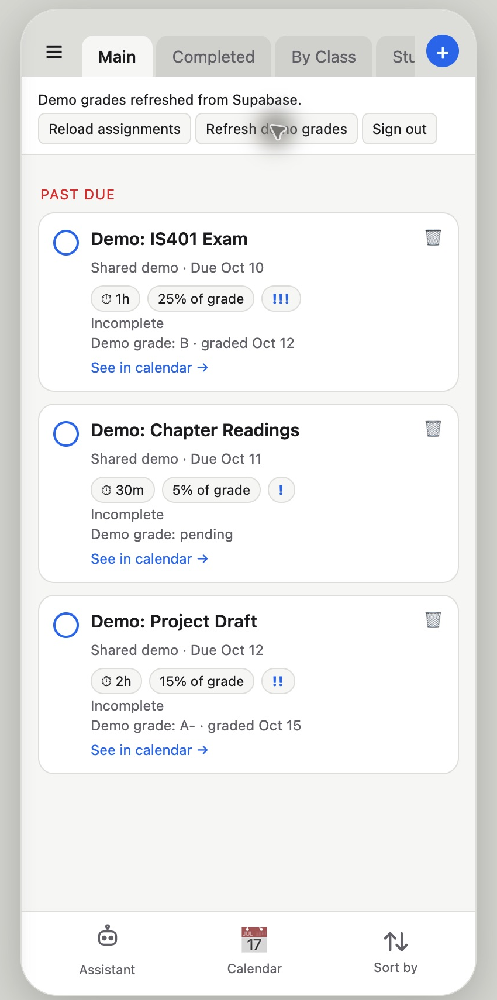

# Supabase demo grade verification — October 30, 2026

Before the migration, a read-only SQL check confirmed that `public.assignment_grades` was absent, the three synthetic assignments still existed, and the shared demo Auth account was present.

Applied `supabase/migrations/202610300001_assignment_grades.sql` to the live `uowlwdwrqceklbqjcnmc` project in the Supabase SQL Editor. The editor returned **Success. No rows returned**.

Ran the role and claim checks represented by `docs/verify-grades.sql`. The result was **PASS** for demo-account read of three grade rows, a pending grade, enabled row-level security, denied browser writes, other-account isolation, and signed-out denial. The verification transaction rolled back and did not change grade data.

Reloaded the signed-in local app at `http://127.0.0.1:4181/`. It showed grades **B** and **A-** for assignments 1 and 3, and **pending** for assignment 2. Clicking **Refresh demo grades** displayed **Demo grades refreshed from Supabase.** No assignment completion values were changed during this check.

These grades remain synthetic. The demo does not connect to Canvas or record a Canvas submission time.
