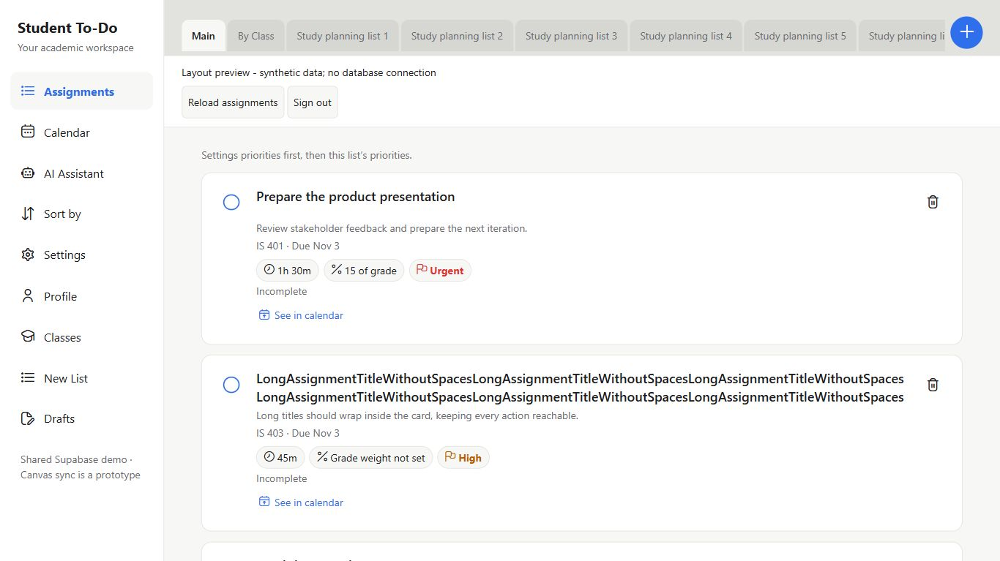
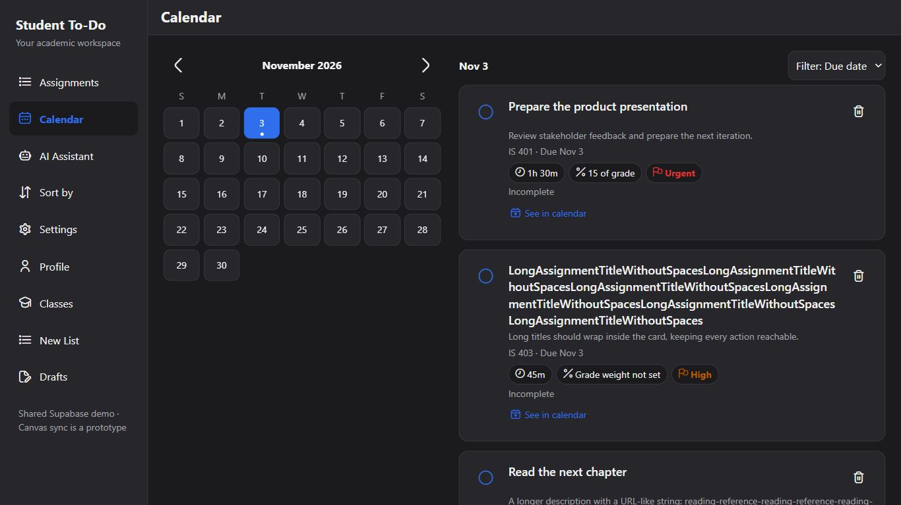
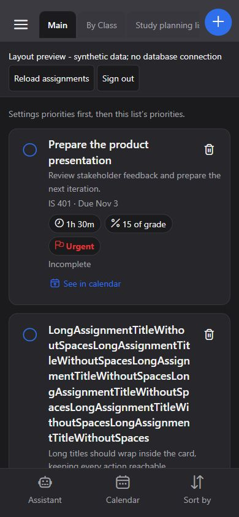
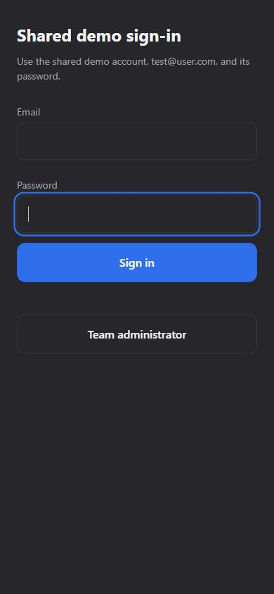

# Laptop responsive layout: review for Lex

Implemented November 3, 2026 on `codex/laptop-responsive`, based on team main `a19b6f2`.
Local implementation only: not pushed, merged, deployed, or accepted in Trello.

## What changed

- Full-height responsive app instead of a 390px phone frame.
- At 900px: 224px persistent sidebar; existing handlers and destinations, including Sort by. Mobile retains its menu and bottom navigation.
- At 1100px: month and selected-day agenda appear side by side. Smaller widths stack them.
- Assignment order and completed/class/custom-list grouping remain unchanged. Titles wrap; controls have 44px targets. Body text is 16px, titles 18px, and assignment metadata 14px.
- Creation/priorities/settings panels have bounded reading widths. Headers, footers, and chat composer remain outside scrolling content.
- Signed-out navigation is hidden. Active navigation and visible keyboard focus are provided; sidebar navigation respects in-progress save locks.

No database, API, AI, theme persistence, deletion, or assignment-editing behavior changed. Original checkout and its uncommitted private Canvas work were preserved in place.

## Browser verification

Used the real application markup/styles and handlers with synthetic in-memory assignments through `tools/layout-preview.cjs`. The fixture does not connect to Supabase or call an AI provider; its chat messages are sample content. These checks establish layout behavior, not live authenticated backend functionality.

| Requested viewport | Measured CSS viewport | Result |
| --- | --- | --- |
| 1366 x 768 | 1367 x 767 | Passed |
| 1440 x 900 | 1440 x 900 | Passed |
| 1024 x 768 | 1024 x 767 | Passed |
| 768 x 1024 | 767 x 1024 | Passed |
| 390 x 844 | 390 x 844 | Passed |

Browser zoom/emulation produced rounding of up to one CSS pixel. `responsive-screenshots/measurements.json` contains the observed results, rather than claiming exact dimensions where they differed.

At all five sizes: no horizontal overflow in assignment lists, calendar, creation form, settings, priorities, or chat; long unbroken titles stayed inside cards; all assignment action targets measured at least 44px (allowing subpixel rounding); form footers and chat composer remained visible; signed-out menu, tabs, and bottom navigation were hidden. Calendar split at laptop widths and stacked at tablet/phone widths.

Additional checks: Main, By Class, and a custom list rendered correctly; Completed remained separate; a populated priority-rule editor fit on phone. Name -> Description and Email -> Password keyboard tab order passed with a visible focus outline. Existing theme controls produced both light and dark layouts. Narrow reflow at 682 x 384 CSS px passed with creation actions visible (equivalent layout space to a 1366 x 768 laptop at 200% zoom).

**Still needs manual verification:** actual native 200% browser zoom, a live signed-in backend smoke test, and PO acceptance. Native zoom could not be reliably changed through browser automation; the reflow check is not a claim that native zoom was tested. Lighthouse was not run, as requested for this stage.

## Functional regression baseline

Before and after this change, 9 of the 10 existing suites pass:
`test.cjs`, `test-lists.cjs`, `test-priorities.cjs`, `test-assignment-create.cjs`, `test-chat.cjs`, `test-chat-assignment.cjs`, `test-chat-backend.mjs`, `test-okr.cjs`, and `test-time-suggestion.cjs`.

`test-local-assignments.cjs:43` already fails on unchanged main: expected `90m`, actual `75m`. It populates the assignment title but not the description and still references the removed `updateTitleSuggestion()` function. This layout change does not fix or conceal that existing test mismatch.

## Review locally

Run `node tools/layout-preview.cjs 4186` and open:

- `http://127.0.0.1:4186/layout-fixture`: synthetic assignment/calendar/form/chat layout review.
- `http://127.0.0.1:4186/signed-out`: login layout without a database connection.
- `http://127.0.0.1:4186/`: normal app, using existing project configuration.

The fixture is a separate local server, not a production route or authentication bypass. Do not use fixture save actions as evidence of persistence.

## Screenshots

